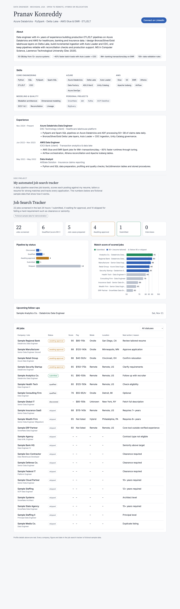
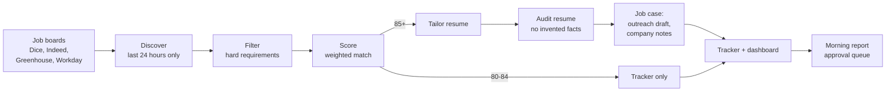

# Data Engineer Job Search Agent

An automated, AI-assisted job search pipeline I built to run my own Data Engineer search. Every night it finds new postings, scores them against my resume, tailors a resume for strong matches, checks that resume for accuracy, drafts recruiter outreach and updates a progress dashboard. Applications are never submitted without my approval.

**Live profile and demo dashboard:** see `index.html` (published with GitHub Pages).



> The dashboard screenshot and `agent/sample_tracker.csv` use fictional sample data. My real tracker, resumes and application details are kept private and are not in this repository.

## How it works



| Step | What it does |
|---|---|
| Discover | Searches job boards and employer applicant-tracking systems. A posting counts as new only if the board's own timestamp proves it is under 24 hours old. |
| Filter | Drops postings that fail a hard requirement (clearance, far more years than I have, contract types I can't take) before scoring, so a high score can never override a hard "no". |
| Score | Weighted heuristic: technical skills 35%, experience 25%, responsibilities 20%, seniority/domain 10%, education 5%, work preferences 5%. |
| Tailor | `agent/tailor_resume.py` rewrites the headline and summary and reorders bullets and skills toward the job description, using only facts from the master resume. |
| Audit | The same script rejects any output that changes an employer, title, date or education line, adds a number that isn't in the master resume, or mentions a technology I haven't used. |
| Report | A daily report lists new matches, tailored resumes, outreach drafts and a numbered "ready to submit" queue for my approval. |

## Guardrails

- **Review before submission.** Nothing is submitted or emailed without an explicit approval.
- **No fabrication.** Personal-project tools stay labeled as personal projects; skills I don't have are listed as gaps, not added to the resume.
- **Untrusted input.** Job descriptions and web pages are treated as data, never as instructions.
- **Privacy.** Real resumes, the tracker and personal details live outside this repo (see `.gitignore`).

The full operating rules are in [`agent/execution_rules.md`](agent/execution_rules.md).

## Repository layout

```
index.html                         Profile page + demo dashboard (GitHub Pages)
assets/dashboard.png               Screenshot of the demo dashboard
agent/tailor_resume.py             Resume tailoring + accuracy audit (python-docx)
agent/execution_rules.md           Rules every run follows
agent/search_preferences.example.json   Example search settings
agent/sample_tracker.csv           Fictional sample tracker data
```

## Running the resume tailor

```bash
pip install python-docx
python3 agent/tailor_resume.py path/to/resume_config.json
```

A config holds the new headline and summary, the bullet and skill order, and the job's keywords. The script writes the tailored `.docx` only if the audit passes, plus a JSON audit report with the change log and keyword coverage.

## Built with

Python, python-docx, HTML/CSS/JavaScript, job-board APIs, and Claude (Anthropic) as the agent that runs the daily workflow.

## About me

Data Engineer with 4+ years building production pipelines on Azure Databricks and AWS (PySpark, Delta Lake, Glue, EMR). [Connect on LinkedIn](https://www.linkedin.com/in/kpranavsai).
